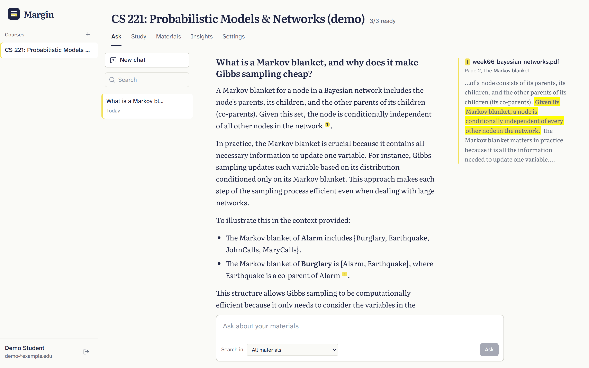
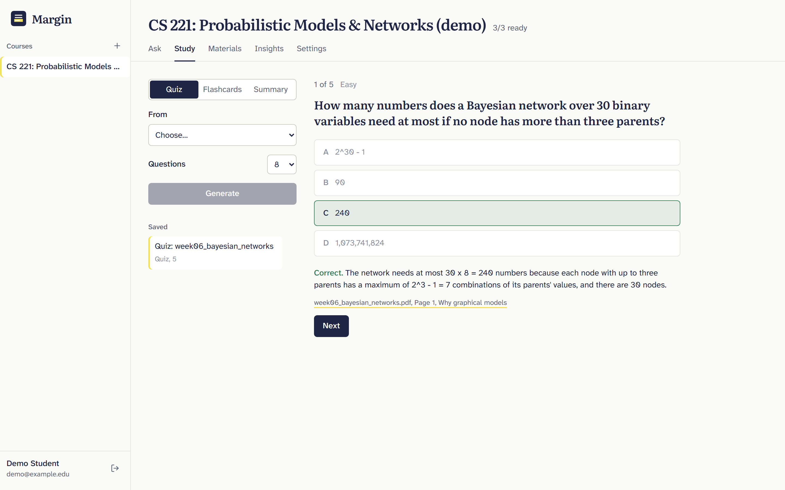

# Margin: an AI knowledge assistant for university courses

Upload lecture slides, notes and textbook chapters; ask questions in any language; get answers
grounded only in those materials, with every claim cited to the page it came from.

  



| Quiz from a lecture | |
|---|---|
|  | Every quiz question, flashcard and answer links back to the page it came from. |

## Features

- Retrieval-augmented chat with streaming answers and citation sidenotes that highlight the
  sentence supporting each claim; source drawer links to the cited PDF page
- Multilingual retrieval (BGE-m3): ask in Arabic, Spanish or French about English notes
- Hybrid dense + sparse search in Qdrant with Reciprocal Rank Fusion, cross-encoder re-ranking
  (bge-reranker-v2-m3) and a relevance threshold that answers "not in your materials" without
  calling the LLM
- Multi-turn chat with history-aware query rewriting
- Study tools: multiple-choice quizzes (with PDF export), flashcards, cached document summaries
- Instructor insights: most-asked and unanswered questions, most-cited documents and sections
- Courses with instructor/student roles; strict per-course isolation in SQL and vector search
- Evaluation harness: retrieval metrics + generation checks + optional RAGAS

## Architecture

```
 React SPA (Vite) ──/api──► FastAPI ──► PostgreSQL   users, courses, documents, chunks,
        ▲  SSE stream           │                     chats, study sets, query logs
        │                       ├──► Qdrant          one collection, course_id tenant index,
        │                       │                     named dense (1024) + sparse vectors
        │                       ├──► embedder        BGE-m3 dense+sparse, bge-reranker-v2-m3
        │                       ├──► Redis ──► worker (ARQ): extract → chunk → embed → index
        │                       └──► LLM             any OpenAI-compatible API
        └── Nginx in production (same origin, so auth cookies stay first-party)
```

**Indexing.** Uploads are validated by magic bytes, stored, and queued. The worker extracts text
per page with PyMuPDF (detecting section headings from font size), splits it with LangChain's
recursive splitter measured in BGE-m3 tokens (800 tokens, 100 overlap), embeds header + text
with BGE-m3 (dense and sparse) and upserts to Qdrant; chunk rows go to Postgres with the same id.

**Answering.** A follow-up question is first rewritten into a standalone query. The query is
embedded (dense + sparse), Qdrant returns the top 20 candidates fused with RRF, the cross-encoder
re-ranks them, weak matches are dropped, and the top 5 are numbered `[Source N]` inside a fenced
`<context>` block. The model is told to answer only from that context and cite it. Tokens stream
back as Server-Sent Events: `session`, `query`, `sources`, `token`…, `done`.

## Tech stack

| Layer | Choice |
|---|---|
| Backend | FastAPI, SQLAlchemy 2 (async) + Alembic, ARQ + Redis |
| Retrieval | Qdrant 1.20, BGE-m3 (dense + sparse), bge-reranker-v2-m3, LangChain text splitters |
| LLM | OpenAI `gpt-4o-mini` by default; any OpenAI-compatible endpoint (Ollama + Qwen locally) |
| Frontend | React 19, Vite, TypeScript, Tailwind CSS 4, TanStack Query, React Router |
| Database | PostgreSQL 16 |
| Ops | Docker Compose, Nginx, GitHub Actions |

## Quick start

```bash
cp .env.example .env            # set LLM_API_KEY (or point LLM_* at Ollama) and JWT_SECRET_KEY
docker compose up --build       # first start downloads BGE-m3 + reranker (~4.5 GB)
```

Open http://localhost:5173, create an account, create a course and upload a PDF.

With an NVIDIA GPU (much faster embedding and re-ranking):

```bash
docker compose -f docker-compose.yml -f docker-compose.gpu.yml up --build
```

Demo data (sample lectures used by the evaluation):

```bash
uv run --project backend python eval/build_corpus.py
cd backend && uv run python scripts/seed_demo.py --api http://localhost:8010
```

The seed script prints the demo course; its local demo login is defined at the top of
`backend/scripts/seed_demo.py`.

### Running services on the host

```bash
docker compose up -d postgres qdrant redis embedder
cd backend && uv sync && uv run alembic upgrade head
uv run uvicorn app.main:app --port 8010          # API
uv run arq app.workers.ingest.WorkerSettings     # ingestion worker
cd ../frontend && npm install && npm run dev     # http://localhost:5173 (proxies /api to :8010)
```

### Local LLM with Ollama

```bash
ollama pull qwen2.5:7b-instruct
# Ollama's default 4k context truncates RAG prompts; raise it before starting the server:
OLLAMA_CONTEXT_LENGTH=16384 ollama serve
```

Then set `LLM_BASE_URL=http://localhost:11434/v1`, `LLM_MODEL=qwen2.5:7b-instruct`,
`LLM_API_KEY=ollama`.

## Configuration

All settings are environment variables (see `.env.example` and `backend/app/core/config.py`).

| Variable | Default | Purpose |
|---|---|---|
| `LLM_BASE_URL`, `LLM_MODEL`, `LLM_API_KEY` | OpenAI, `gpt-4o-mini` | Chat model (OpenAI-compatible) |
| `JWT_SECRET_KEY` | dev value | Required in production (startup refuses the default) |
| `EMBEDDER_URL` | `http://localhost:8001` | BGE-m3 service; `EMBEDDER_BACKEND=hash` for tests |
| `HYBRID_SEARCH`, `RERANK_ENABLED`, `RERANK_THRESHOLD` | on, on, 0.1 | Retrieval pipeline |
| `RETRIEVAL_TOP_K`, `RERANK_TOP_N` | 20, 5 | Candidates re-ranked, passages sent to the LLM |
| `CHUNK_SIZE_TOKENS`, `CHUNK_OVERLAP_TOKENS` | 800, 100 | Chunking (BGE-m3 tokens) |
| `QUERY_REWRITE`, `MULTI_QUERY` | on, off | LLM query processing |
| `RATE_LIMIT_CHAT`, `RATE_LIMIT_UPLOAD` | `20/minute`, `10/minute` | Per-user limits |

## Project structure

```
backend/      FastAPI app, Alembic migrations, ARQ worker, tests
  app/api/routes/        auth, courses, documents, chat (SSE), study, analytics, health
  app/services/          ingestion/, retrieval/, llm/, vectorstore/, rag.py, study.py
embedder/     BGE-m3 + reranker HTTP service (hash backend for CI)
frontend/     React SPA; Nginx config for production
eval/         sample corpus, golden dataset, run_eval.py, reports/
```

## Evaluation

`eval/golden_dataset.jsonl` holds 52 questions about the sample corpus (46 factual, 3
cross-lingual, 3 unanswerable), each with the exact evidence text, so relevance labels don't
depend on chunking.

```bash
uv run --project backend python eval/run_eval.py --configs baseline,hybrid,rerank,hybrid_rerank
uv run --project backend python eval/run_eval.py --configs hybrid_rerank --generate [--ragas]
```

Reports are written to `eval/reports/`. See [eval/RESULTS.md](eval/RESULTS.md) for the current
numbers and what changed because of them. Headline: re-ranking took first-result accuracy from
0.90 to 0.96, and the reranker score threshold separates answerable from unanswerable questions
(lowest answerable 0.386, highest unanswerable 0.011), so off-topic questions get "not found"
without an LLM call.

Load test (Locust, see `eval/locustfile.py`): with a fake LLM the stack sustains about 3
questions/s with no errors on one laptop GPU, bounded by the reranker; with a local 7B model the
LLM is the bottleneck.

## Security

- Passwords hashed with bcrypt; JWTs in httpOnly, SameSite=Lax cookies plus a double-submit
  CSRF token on writes; Bearer tokens for API clients
- Every course route checks membership (404 for non-members), and the vector store wrapper
  always filters by `course_id`
- Uploads checked by magic bytes and extension; PDFs with JavaScript or launch actions rejected;
  stored under random names
- Retrieved text is fenced as untrusted data in the prompt; a pattern check flags injection
  attempts in questions
- Per-user rate limits on chat, uploads and generation; security headers from Nginx

## Tests

```bash
cd backend && uv run pytest     # 47 tests; needs the Postgres container (port 5433)
cd frontend && npm test         # unit tests (SSE parser, citation helpers)
npx playwright install chromium && npm run e2e   # stack running + seed_demo.py; desktop + mobile
```

Backend tests use real Postgres, in-process Qdrant, hash embeddings and a fake LLM, so they need
no model downloads or API keys.
